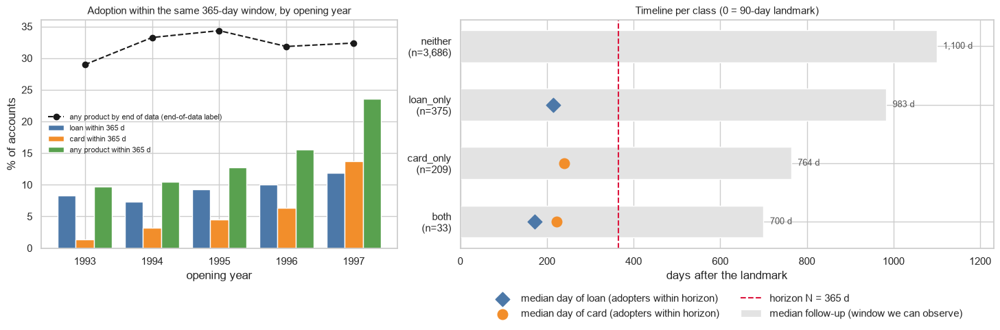
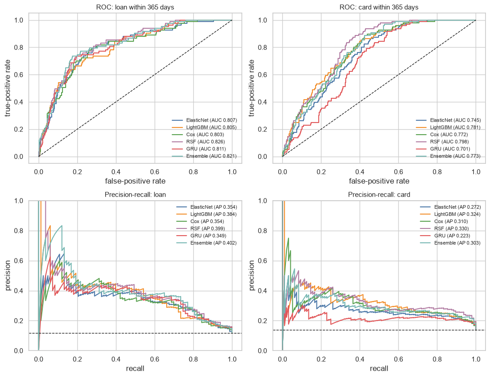
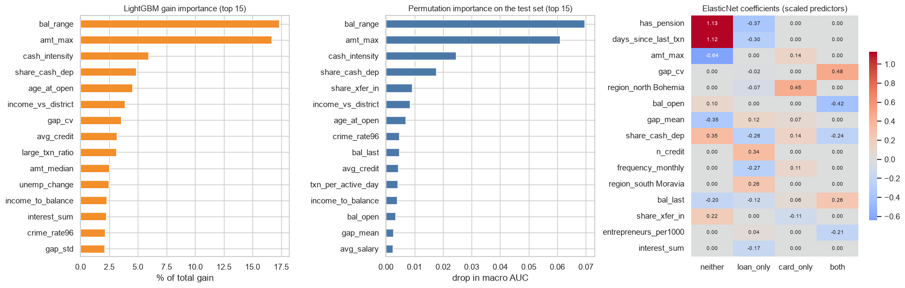

# Predicting Next-Best-Product Adoption in Retail Banking from the First 90 Days of Transactions

End-to-end machine learning, survival analysis, and temporal point process pipeline predicting customer adoption of retail banking products (`loan_only`, `card_only`, `both`, or `neither`) within a 365-day horizon following a 90-day transaction landmark.

**Author:** Anushree Das  
**Course:** ANA540 Machine Learning — Final Project  
**Paper / Report:** [`Predicting_Next_Best_Product_Adoption_in_Retail_Banking.pdf`](./Predicting_Next_Best_Product_Adoption_in_Retail_Banking.pdf)

---

## Overview

Banks typically score checking-account customers for cross-selling offers using static snapshot aggregates and frame adoption as an isolated binary outcome. However, evaluating full transaction histories introduces severe **target leakage** (e.g., loan repayments with purpose `UVER` and credit card withdrawals occur only *after* product adoption), while end-of-data labels suffer from unequal observation windows (right censoring) and strong **cohort shift** as bank product offerings evolve over calendar time.

This project formulates Next-Best-Product (NBP) recommendation under a strict **survival landmarking framework**:
1. **Observation Window (Landmark):** Only transactions from each customer's **first 90 days** after account opening (`days 0–90`) plus static client and district attributes are used as predictors.
2. **Prediction Horizon:** Models predict four mutually exclusive product adoption outcomes over the subsequent **365 days** (`days 91–455`): `neither`, `loan_only`, `card_only`, or `both`.
3. **Out-of-Time Evaluation:** Models are trained on accounts opened in **1993–1996** ($n = 3,602$) and evaluated on the held-out **1997 opening cohort** ($n = 701$), using two expanding-window temporal validation folds (`1993–94 → 1995` and `1993–95 → 1996`) for hyperparameter search, feature selection, and cost-sensitive decision threshold optimization.



---

## Dataset

**Source:** [Berka PKDD'99 Financial Dataset](https://relational.fit.cvut.cz/dataset/Financial) (anonymized records from a Czech retail bank, Jan 1993 – Dec 1998), packaged in [`berka.zip`](./berka.zip).

| Table | Rows | Description |
|---|---:|---|
| `account.csv` | 4,500 | Checking accounts, opening dates, statement issuance frequency |
| `client.csv` | 5,369 | Client birth dates, gender, and district identifiers |
| `disp.csv` | 5,369 | Dispositions linking clients to accounts (`OWNER` vs. authorized `DISPONENT`) |
| `trans.csv` | 1,056,320 | Timestamped transactions (type, operation, amount, post-transaction balance, `k_symbol` purpose) |
| `order.csv` | 6,471 | Standing payment orders |
| `loan.csv` | 682 | Granted loans (date, amount, duration, monthly payment, repayment status) |
| `card.csv` | 892 | Issued credit cards (issuance date and tier) |
| `district.csv` | 77 | Demographic and economic indicators for 77 Czech districts |

After filtering out 197 accounts with fewer than 365 days of post-landmark follow-up prior to the administrative censoring date (`1998-12-31`), the modeling cohort comprises **4,303 accounts**:

| Class | Train (`1993–1996`) | Test (`1997`) | Total |
|---|---:|---:|---:|
| `neither` | 3,150 (87.5%) | 536 (76.5%) | 3,686 (85.7%) |
| `loan_only` | 306 (8.5%) | 69 (9.8%) | 375 (8.7%) |
| `card_only` | 127 (3.5%) | 82 (11.7%) | 209 (4.9%) |
| `both` | 19 (0.5%) | 14 (2.0%) | 33 (0.8%) |
| **Total Accounts** | **3,602** | **701** | **4,303** |
| **Any Product Adopted** | **12.5%** | **23.5%** | **14.3%** |

---

## Methodology & Model Families

Seven modeling approaches spanning four methodological paradigms are compared:

1. **Prior Baseline:** Predicts training class proportions (`DummyClassifier`).
2. **ElasticNet Multinomial Logistic Regression:** Regularized linear model ($L_1 + L_2$ penalty) trained on median-imputed, signed-log transformed, z-scored, and Spearman-pruned ($|\rho| \le 0.90$) base features (41 inputs).
3. **LightGBM:** Multiclass gradient-boosted decision trees capturing nonlinear interactions across base + 10 domain-engineered behavioral ratios (`bal_range`, `cash_intensity`, `income_to_balance`, `large_txn_ratio`, `income_vs_district`, etc.; 51 inputs).
4. **Cause-Specific Cox Proportional Hazards (`lifelines`):** Separate ridge-penalized survival models for loan and card time-to-adoption using right-censored follow-up, converted to 4-class horizon probabilities at $H = 365$ days.
5. **Random Survival Forest (`scikit-survival`):** Non-parametric survival ensembles modeling nonlinear hazard surfaces on the top-15 gain-ranked features.
6. **RMTPP-Style Recurrent Neural Network (`PyTorch`):** A Gated Recurrent Unit (GRU) sequence encoder operating directly on each customer's timestamped 90-day transaction stream (inter-arrival log-gaps, log-amounts, normalized timestamps, and learned categorical embeddings for `type`, `operation`, and `k_symbol`), fused with static attributes and trained with a joint cross-entropy + temporal point process survival loss.
7. **Equal-Weight Probability Ensemble:** Combines the calibrated four-class probability vectors of the five tuned models (`ElasticNet`, `LightGBM`, `Cox`, `RSF`, `GRU`).

### Decision Rule Optimization
Under severe class imbalance (87.5% `neither` in training), standard `argmax` classification collapses to predicting the majority class (`macro-F1 = 0.217`) even when models achieve strong ranking discrimination (`macro AUC = 0.77–0.82`). To bridge ranking and hard decisions without leaking test labels, out-of-fold validation probabilities are rescaled by $[1, w_{\text{loan}}, w_{\text{card}}, w_{\text{loan}} w_{\text{card}}]$ over a $48 \times 48$ logarithmic grid to maximize out-of-fold macro-F1.

---

## Key Results

### Held-Out Test Set Performance (1997 Cohort, $n = 701$)

95% confidence intervals are computed via 1,000 paired account-level bootstrap resamples:

| Model | Variant | Accuracy | Macro-F1 [95% CI] | Macro AUC [95% CI] | Loan PR-AUC | Card PR-AUC |
|---|---|---:|---|---|---:|---:|
| **Prior Baseline** | `initial` | 0.765 | 0.217 [0.212, 0.221] | 0.500 [0.500, 0.500] | 0.118 | 0.137 |
| **ElasticNet LR** | `initial` | 0.763 | 0.216 [0.212, 0.221] | 0.780 [0.745, 0.812] | 0.353 | 0.278 |
| | `tuned + rule` | 0.698 | 0.377 [0.322, 0.429] | 0.780 [0.746, 0.812] | 0.354 | 0.272 |
| **LightGBM** | `initial` | 0.763 | 0.254 [0.228, 0.283] | 0.763 [0.726, 0.798] | 0.300 | 0.275 |
| | `tuned + rule` | 0.625 | 0.399 [0.357, 0.444] | 0.790 [0.758, 0.820] | 0.384 | 0.324 |
| **Cox (Cause-Specific)** | `initial` | 0.765 | 0.217 [0.212, 0.221] | 0.777 [0.745, 0.805] | 0.282 | 0.281 |
| | `tuned + rule` | 0.601 | 0.383 [0.341, 0.421] | 0.802 [0.775, 0.827] | 0.354 | 0.310 |
| **Random Survival Forest** | `initial` | 0.765 | 0.217 [0.212, 0.221] | 0.809 [0.783, 0.834] | 0.393 | 0.300 |
| | **`tuned + rule`** | **0.709** | **0.432 [0.380, 0.482]** | **0.821 [0.794, 0.845]** | 0.399 | **0.330** |
| **RMTPP-Style GRU** | `initial` | 0.765 | 0.217 [0.212, 0.221] | 0.762 [0.730, 0.794] | 0.346 | 0.236 |
| | `tuned + rule` | 0.623 | 0.334 [0.291, 0.377] | 0.767 [0.737, 0.797] | 0.349 | 0.223 |
| **Ensemble** | **`tuned + rule`** | 0.643 | 0.404 [0.361, 0.448] | 0.805 [0.779, 0.831] | **0.402** | 0.303 |



### Key Takeaways
- **Survival & Tree Ensembles Excel on Medium Tabular Horizons:** **Random Survival Forest (RSF)** achieves the highest test macro ROC-AUC (`0.821`), highest macro-F1 (`0.432`), highest card PR-AUC (`0.330`, $2.4\times$ base rate), and strongest survival concordance (`C-index = 0.803` for loans, `0.766` for cards). The **CV-selected Ensemble** achieves the highest loan PR-AUC (`0.402`, $3.4\times$ base rate).
- ** Ranking vs. Hard Thresholding:** Hyperparameter tuning and engineered features improve ranking metrics (PR-AUC and ROC-AUC), whereas the out-of-fold cost-sensitive **decision rule** drives the jump in hard-classification macro-F1 from `0.217` to `0.334–0.432` by recovering minority product adopters.
- **Aggregate Features Outperform Raw Event Sequences:** With a median of only 9 transactions per account in the first 90 days and $N = 3,602$ training accounts, domain-engineered tabular aggregates (`bal_range`, `amt_max`, `cash_intensity`, `share_cash_dep`) outperform the RMTPP-style GRU sequence model while exhibiting much lower variance across random seeds (`RSF macro-F1 = 0.422 ± 0.009` vs. `GRU = 0.370 ± 0.028`).



---

## Repository Structure

```text
berka-next-best-product/
├── README.md                                                     # Project overview, methodology, and results
├── requirements.txt                                              # Python package dependencies
├── .gitignore                                                    # Git ignore rules for OS/cache/uncompressed files
├── Final_Project_NBP_Berka.ipynb                                 # Complete reproducible notebook (EDA → Models → Tuning → Eval)
├── Predicting_Next_Best_Product_Adoption_in_Retail_Banking.pdf   # Final 11-page technical paper (IEEE/ACM two-column format)
├── berka.zip                                                     # Compressed Berka PKDD'99 dataset (8 CSV tables)
├── figures/                                                      # All 23 publication-quality PNG plots generated by the notebook
├── results/                                                      # All 24 CSV result tables + best_config.json
└── archive/                                                      # Earlier iterative milestones
    ├── Assignment_Week6.ipynb                                    # Week 6 baseline & survival modeling milestone
    └── Assignment_Week7.ipynb                                    # Week 7 hyperparameter optimization & evaluation milestone
```

---

## How to Run

1. **Clone the repository and install dependencies:**
   ```bash
   git clone https://github.com/anushreedas/berka-next-best-product.git
   cd berka-next-best-product
   pip install -r requirements.txt
   ```

2. **Launch Jupyter and run the notebook:**
   ```bash
   jupyter notebook Final_Project_NBP_Berka.ipynb
   ```
   - **Automatic Data Extraction:** Keep `berka.zip` in the root directory. Section 1.4 of `Final_Project_NBP_Berka.ipynb` automatically extracts `berka.zip` into `./berka/` on first run if the folder is not already present.
   - **Execution Time:** A full end-to-end run (including survival forests, multiprocess PyTorch GRU search, 1,000 bootstrap resamples, and 5-seed stability checks) takes ~30–60 minutes on a laptop. Set `FAST_MODE = True` in Section 5 for a quick ~3-minute verification run.
